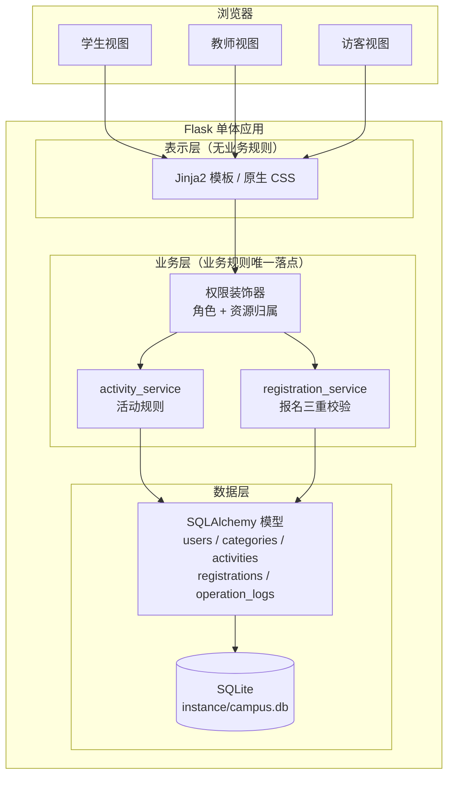
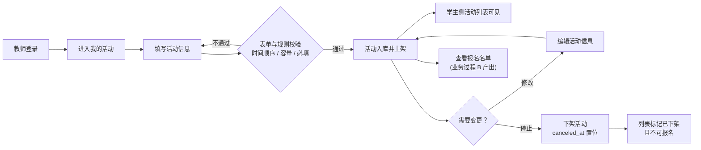
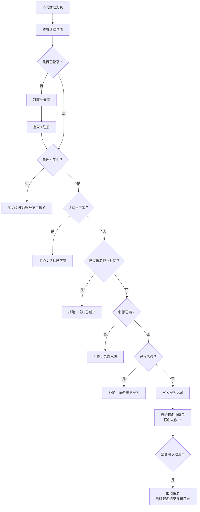
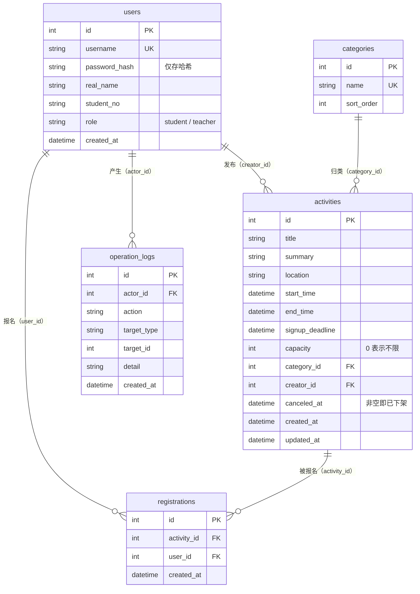

# 软件设计 —— 校园活动管理系统 V1.0

> 依据：`01-需求分析.md`（REQ-01 ~ REQ-06）与 `02-工程意图.md`（约束 C1 ~ C6、完成依据 E1 ~ E5）。
> 本设计的目标不是"画全所有图"，而是**能够对后续实现形成实际指导，并与最终软件保持一致**。

---

## 1. 设计目标

围绕 V1.0 的工程意图（验证「发布 → 浏览 → 报名」闭环是否成立），设计需要回答三个问题：

1. 软件由哪些部分组成，各自负责什么
2. 这些部分之间如何协作，一次请求经过哪些环节
3. 关键业务规则（报名三重校验、权限边界、活动状态）落在哪一层，如何保证不被绕过

设计刻意**不追求图表的完整性和形式上的完备**，只保留对实现有约束力的部分。

---

## 2. 总体设计

### 2.1 结构选型

V1.0 采用 **单体应用 + 三层结构**，服务端渲染：

```
浏览器  ──HTTP──▶  Flask 应用（单体进程）
                     ├── 表示层：Jinja2 模板 + 原生 CSS
                     ├── 业务层：service（活动、报名规则）
                     └── 数据层：SQLAlchemy 模型 + SQLite 单文件
```

选型理由：V1.0 要验证的是**业务规则是否正确**，而不是前端工程能力。三层单体把复杂度
集中在业务规则上，同时保留清晰的分层边界，后续如需拆分不会推倒重来。

### 2.2 三层职责划分

| 层 | 组成 | 职责 | 是否允许写业务规则 |
|---|---|---|---|
| 表示层 | `templates/`、`static/` | 展示数据、收集表单输入、呈现校验结果 | **否** |
| 业务层 | `services/` | 业务规则判定、状态推导、事务提交 | **是（唯一）** |
| 数据层 | `models.py`、SQLite | 数据持久化、字段级约束（唯一约束、非空） | 仅结构性约束 |

**关键约定**：视图函数（routes）只负责"取参数 → 调 service → 渲染结果"，
一切业务判断都在 service 层实现。这样可以保证同一条规则不会因为入口不同而被绕过。

### 2.3 模块划分

| 模块 | 路径 | 承担的职责 | 对应需求 |
|---|---|---|---|
| 主模块 | `app/main/` | 首页、可用性探针 | —— |
| 认证模块 | `app/auth/` | 注册、登录、登出、表单校验 | REQ-01 |
| 权限装饰器 | `app/decorators.py` | 角色校验、资源归属校验 | REQ-02 |
| 活动模块 | `app/activities/` | 活动发布 / 修改 / 下架 / 列表 / 筛选 / 详情 | REQ-03、REQ-04 |
| 报名模块 | `app/registrations/` | 报名、取消报名、我的报名、报名名单 | REQ-05、REQ-06 |
| 活动服务 | `app/services/activity_service.py` | 活动表单校验与状态变更规则 | REQ-03 |
| 报名服务 | `app/services/registration_service.py` | 报名三重校验（约束 C2） | REQ-05 |
| 数据模型 | `app/models.py` | 五张表与业务状态定义 | 全部 |

### 2.4 系统结构图



### 2.5 一次请求的处理主线

以"学生提交报名"为例，说明各层如何协作：

```
POST /activities/12/signup
  └─ 表示层：详情页表单提交活动 id
      └─ 装饰器 student_required：未登录 → 跳登录页；角色非学生 → 403
          └─ 业务层 registration_service.signup(activity, user)
              ├─ 校验 1：活动是否已下架
              ├─ 校验 2：是否已过报名截止时间     ← 约束 C2
              ├─ 校验 3：名额是否已满             ← 约束 C2
              ├─ 校验 4：是否重复报名             ← 约束 C2
              ├─ 通过 → 写入 registrations（唯一约束再次兜底）
              └─ 写 operation_logs 记录本次报名
                  └─ 数据层：commit
                      └─ 表示层：重定向回详情页 + flash 提示结果
```

---

## 3. 核心业务流程

### 3.1 业务过程 A：教师发布并管理活动



要点：**下架是软下架**——活动记录与已有报名数据保留，只是不再出现在"可报名"的
活动中。这样做的原因是历史报名数据本身是资产（对应 P5），不应该因为活动结束而消失。

### 3.2 业务过程 B：学生查看活动并报名（V1.0 核心流程）

这是 V1.0 最关键的一条流程，也是约束 C2 的落点：



**说明**：S7 ~ S14 五个判断分支全部在 `registration_service.signup()` 内实现，
且即使前四个分支因并发或重复提交而全部通过，第 5 个分支仍会被数据库唯一约束拦下
（见第 5 节决策 D4）。

### 3.3 活动状态推导规则

活动状态不落库，由当前时间与各时间字段推导（约束 C4）：

| 状态 | 推导条件 | 学生可否报名 |
|---|---|---|
| 已下架 | `canceled_at` 非空 | 否 |
| 报名中 | 当前时间 ≤ 报名截止 且 当前时间 < 开始时间 | **是**（且未满员） |
| 报名已截止 | 报名截止 < 当前时间 < 开始时间 | 否 |
| 进行中 | 开始时间 ≤ 当前时间 ≤ 结束时间 | 否 |
| 已结束 | 当前时间 > 结束时间 | 否 |

推导而非存储的好处：不存在"状态字段与真实时间不一致"的脏数据，也不需要定时任务
去刷新状态——这在"单机可运行、零外部依赖"的约束（C5）下是必要的选择。

---

## 4. 数据设计

### 4.1 实体关系



### 4.2 数据对象清单

| 数据对象 / 表 | 关键字段 | 主要用途 | 与其他数据的关系 |
|---|---|---|---|
| `users` 用户 | `id`、`username`(唯一)、`password_hash`、`real_name`、`student_no`、`role` | 支撑 REQ-01 注册登录；`role` 区分学生与教师，是全系统权限判断的依据 | 一个用户可发布多个活动；一个用户可有多条报名记录；是操作日志的行为主体 |
| `categories` 活动分类 | `id`、`name`(唯一)、`sort_order` | 支撑 REQ-04 的活动分类筛选，让学生能按"讲座 / 文体 / 志愿"等维度定位活动 | 一个分类下可有多个活动 |
| `activities` 活动 | `id`、`title`、`summary`、`location`、`start_time`、`end_time`、`signup_deadline`、`capacity`、`category_id`、`creator_id`、`canceled_at` | 全系统的核心对象，承载 REQ-03 发布管理与 REQ-04 浏览；`signup_deadline` 与 `capacity` 是 REQ-05 报名校验的直接依据 | 属于一个分类，由一位教师创建，可被多名学生报名 |
| `registrations` 报名记录 | `id`、`activity_id`、`user_id`、`created_at`；**(activity_id, user_id) 唯一** | 支撑 REQ-05 报名与 REQ-06 报名名单；唯一约束是防止重复报名的数据库级保证 | 连接用户与活动，是"谁报了哪个活动"的唯一事实来源 |
| `operation_logs` 操作日志 | `id`、`actor_id`、`action`、`target_type`、`target_id`、`detail`、`created_at` | 记录发布 / 下架 / 报名 / 取消报名等关键动作，使"需求—实现—验证"可追溯 | 每条日志关联一个操作者；`target_id` 指向被操作的活动 |

### 4.3 关键字段的设计说明

- **`activities.canceled_at`**：用"时间戳非空"表示下架，而不是布尔字段。既表达了状态，
  又保留了"何时下架"的信息，且不会与 `status` 推导逻辑冲突。
- **`activities.capacity = 0`**：约定 0 表示不限人数，避免使用 `NULL` 带来的三值逻辑
  判断负担（`capacity is None` 与 `capacity == 0` 语义容易混淆）。
- **`registrations` 唯一约束**：命名 `uq_registration_activity_user`，是防重复报名的
  最终防线，不依赖应用代码的正确性。
- **`users.password_hash`**：只存哈希，字段命名刻意强调其类型，防止误把明文写进该字段。

---

## 5. 关键设计决策

| 编号 | 决策 | 理由 | 影响 |
|---|---|---|---|
| **D1** | 采用服务端渲染的单体结构，不做前后端分离 | V1.0 的验证目标是业务规则是否正确。前后端分离会引入构建链、跨域、Token 鉴权、前端状态管理一整套与业务规则无关的复杂度，在 2 学时规模下会挤占验证精力 | 页面交互依赖整页刷新，前端体验朴素；但业务规则集中、可被完整测试 |
| **D2** | 业务规则集中在 `services/` 层，视图层不写判断 | 同一条规则如果散落在多个视图里，很容易出现"某个入口漏判"的情况。集中一处后，报名三重校验（C2）只有一份实现 | 视图函数变薄；service 成为测试的主要对象 |
| **D3** | 活动状态由时间推导，不作为可写字段 | 状态字段一旦落库，就必须靠定时任务或写入时的额外逻辑来维护，容易出现"时间已经过了但状态还是报名中"的不一致 | 列表筛选中"状态"需要在 Python 侧过滤，而非 SQL 直接 `where`；换来的是数据永远自洽 |
| **D4** | 防重复报名采用"应用层校验 + 数据库唯一约束"双重保证 | 应用层校验在并发重复提交、用户双击等场景下可能同时通过；数据库唯一约束是最终防线，代价极低 | 需要在写入时捕获 `IntegrityError` 并转成友好提示，否则会抛 500 |
| **D5** | 下架采用软下架（保留 `canceled_at` 与报名数据） | 历史报名记录本身承载业务价值（对应问题 P5 "谁报过名无从查起"），不应随活动下架而丢失 | 所有面向学生的查询都要显式排除已下架活动，避免遗漏造成"下架了还能报名" |

---

## 6. 设计与需求的对应关系

| 需求 | 设计中的落点 |
|---|---|
| REQ-01 注册登录与密码安全 | `users` 表 + `auth` 模块 + 约束 C1（`password_hash`） |
| REQ-02 角色权限 | `users.role` + `decorators.py`（角色校验、资源归属校验，约束 C3） |
| REQ-03 活动发布与管理 | `activities` 表 + `activity_service` + 决策 D5（软下架） |
| REQ-04 活动浏览与筛选 | `categories` 表 + `activities` 列表 / 详情 + 决策 D3（状态推导） |
| REQ-05 报名与取消 | `registrations` 表 + `registration_service` 三重校验 + 决策 D4（唯一约束） |
| REQ-06 报名名单 | `registrations` 表 + `users` 关联查询 + 决策 D2（规则集中） |

---

## 7. 设计在实现过程中的调整

实现阶段与验证阶段对设计做出的调整，均记录在此（并对应 Git 提交与实验报告 6.3）：

| 时间点 | 原设计 | 调整后 | 调整原因 |
|---|---|---|---|
| 实现报名模块时 | 报名校验只校验"未满员"与"未重复报名" | 补充"未过报名截止时间"校验 | 初次实现遗漏，验证阶段 TEST-05 用例发现学生在截止后仍可报名，属于业务规则缺失 |

除上述一项外，最终实现与本节设计基本一致：模块划分、表结构、状态推导规则与关键决策
均未发生结构性变化。
